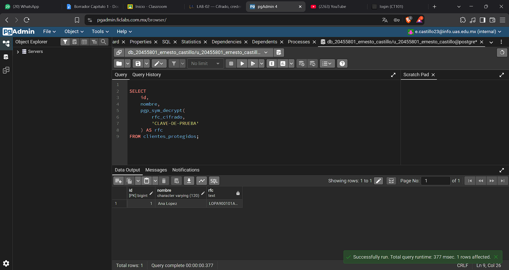

## Evidencia 2: Cifrado de datos sensibles

## Objetivo

Demostrar cómo proteger un dato sensible mediante cifrado simétrico y comprobar que puede recuperarse utilizando la clave correcta.

## Comando o procedimiento

Se ejecutó el archivo sql/02-cifrado-datos.sql, que crea la tabla clientes_protegidos. El RFC ficticio LOPA900101ABC se cifra mediante pgp_sym_encrypt() y se almacena en una columna de tipo BYTEA. Después se utilizó pgp_sym_decrypt() para recuperar el valor original mediante la misma clave de demostración.

## Resultado obtenido

La consulta de la tabla muestra el campo cifrado en una representación binaria que no presenta directamente el RFC en texto legible. Al utilizar la clave correcta para descifrarlo, se recupera el valor original.

## Análisis

1. ¿Cuál es la diferencia entre crypt() y pgp_sym_encrypt()?

La función crypt() se utiliza para generar y verificar hashes de contraseñas. No está diseñada para recuperar la contraseña original.

La función pgp_sym_encrypt() cifra información mediante una clave simétrica, lo que permite recuperar el dato original utilizando la función correspondiente y la clave correcta.

2. ¿Cuál permite recuperar el dato original?

pgp_sym_encrypt() permite recuperar el dato original mediante pgp_sym_decrypt(), siempre que se proporcione la clave correcta y los datos cifrados sean válidos. Un hash de contraseña generado mediante crypt() no se descifra para recuperar la contraseña original.

3. ¿Qué ocurre si se utiliza una clave incorrecta?

El descifrado normalmente falla y PostgreSQL devuelve un error de descifrado o de autenticación del mensaje. No se debe asumir que cualquier clave permitirá recuperar la información.

4. ¿Por qué es peligroso escribir una clave directamente en una consulta?

La clave puede quedar expuesta en archivos SQL, historiales, registros de ejecución, capturas de pantalla o repositorios de código. Una persona que obtenga la clave y el dato cifrado podría recuperar la información protegida.

## Conclusion

El cifrado mantiene protegida informacion sensible dentro de las bases de datos pero si no se manejan correctamente las claves puede ser contraproducente.

Evidencias

