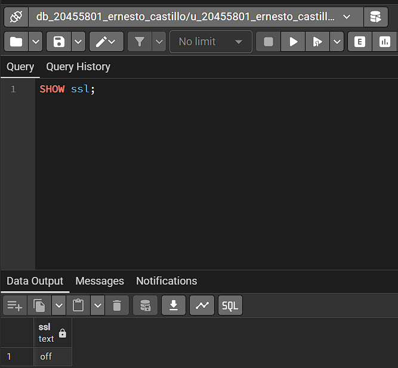
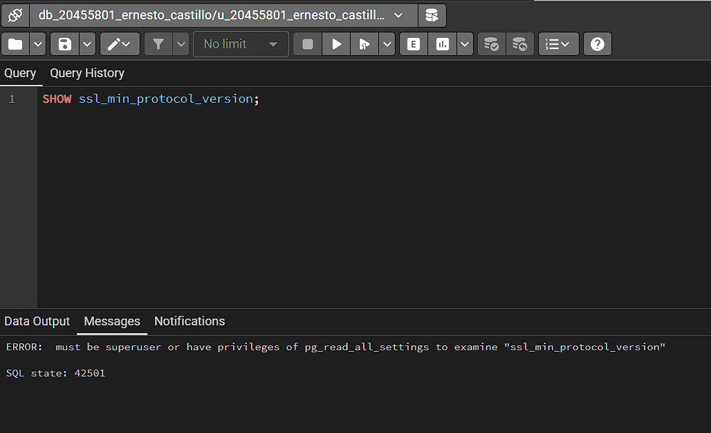
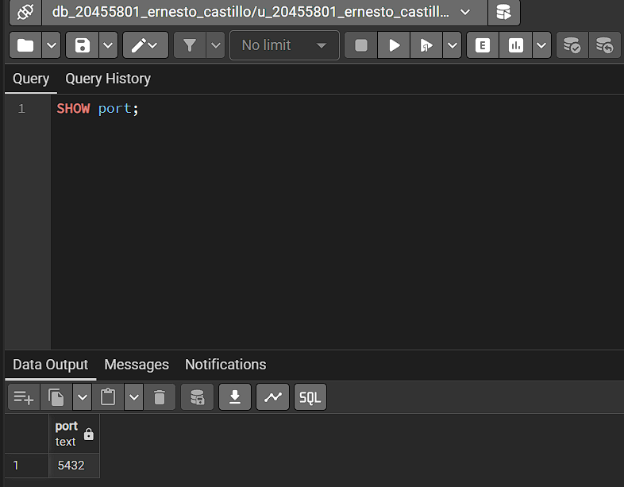
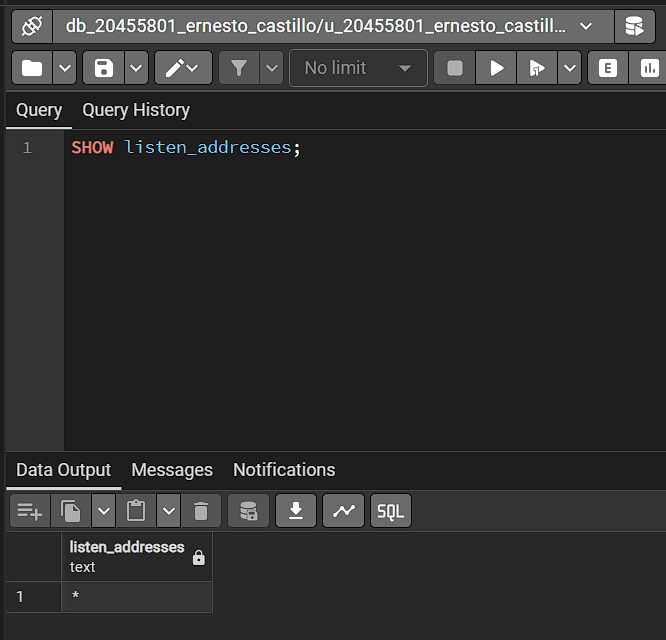
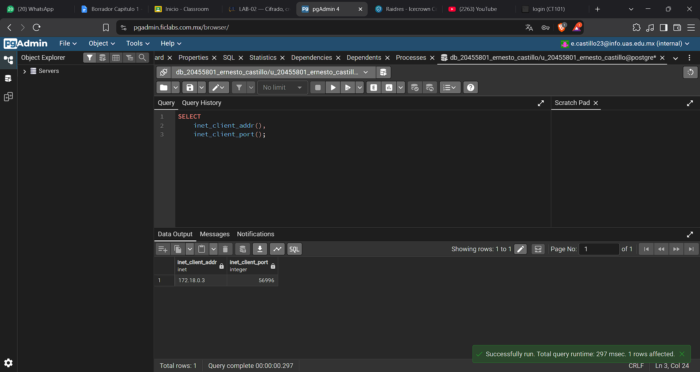
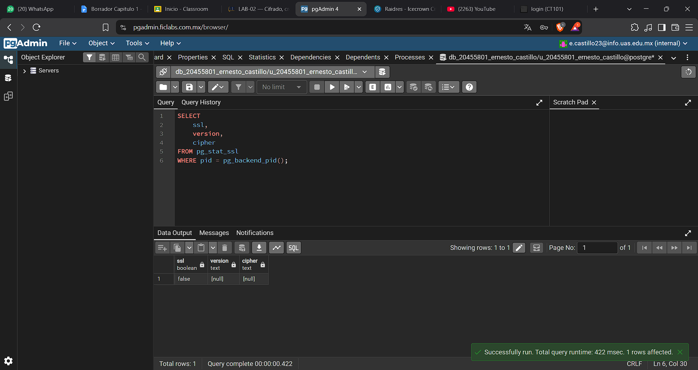
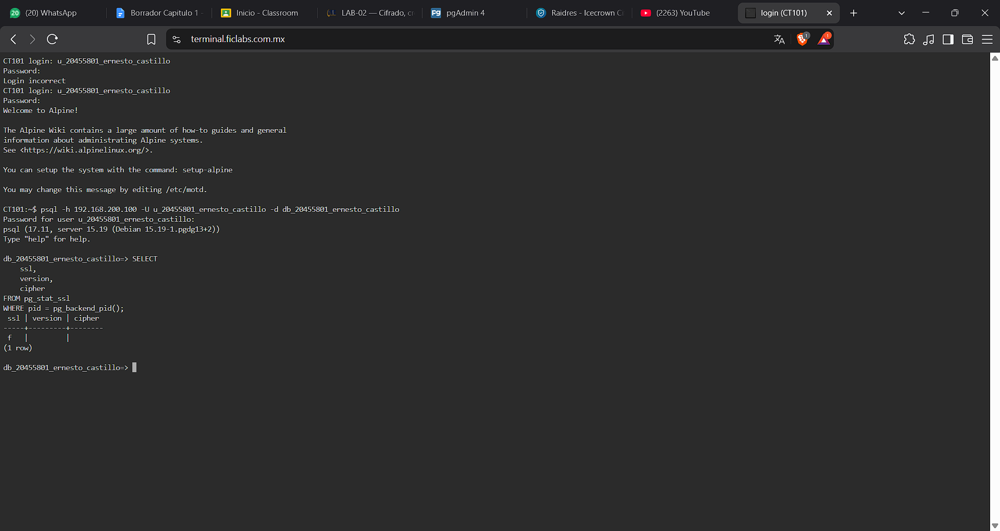

## Evidencia 4: Verificación de TLS en PostgreSQL

## Objetivo

Comprobar la configuración SSL/TLS de PostgreSQL y determinar si la conexión actual utiliza cifrado para proteger las comunicaciones entre el cliente y el servidor.

## Comando o procedimiento

SHOW ssl;
SHOW ssl_min_protocol_version;
SHOW port;
SHOW listen_addresses;

## Direccion de cliente:

SELECT
    inet_client_addr(),
    inet_client_port();

Se verificó el estado de cifrado de la sesión actual:

SELECT
    ssl,
    version,
    cipher
FROM pg_stat_ssl
WHERE pid = pg_backend_pid();

Se realizó una prueba adicional desde psql, cuando estuvo disponible, para comprobar el comportamiento de una conexión que solicita TLS.

## Resultado obtenido

En la captura de SHOW ssl se observa que SSL está desactivado (off). En la consulta a pg_stat_ssl, el resultado de la sesión actual muestra ssl = false, con la versión y el algoritmo de cifrado sin valores disponibles.

También se produjo un error de permisos al consultar ssl_min_protocol_version. Por ello, no se pudo confirmar ese parámetro mediante esa consulta.

## Análisis

1. ¿La conexión actual utiliza TLS?

Según la captura de pg_stat_ssl, la conexión consultada no utiliza TLS porque el valor de ssl es false.

2. ¿Qué versión de TLS se está utilizando?

No se muestra, ya que sale false

3. ¿Qué algoritmo de cifrado aparece?

No aparece ningún algoritmo de cifrado en la captura porque el campo cipher tiene un valor nulo.

4. ¿Qué diferencia existe entre una conexión protegida con TLS y una conexión sin TLS?

TLS proporciona confidencialidad e integridad de los datos transmitidos y, cuando se configura correctamente la validación de certificados, permite comprobar la identidad del servidor. Una conexión sin TLS puede exponer la información transmitida a personas que puedan observar el tráfico de red.

## Conclusión

Las capturas muestran que la sesión consultada no utiliza TLS.

## EVIDENCIAS:

