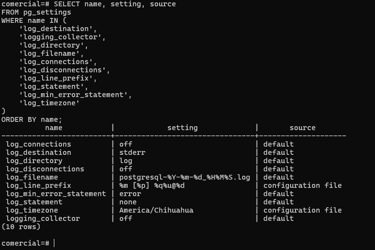

## Consulta ejecutada

```sql
SELECT name, setting, source
FROM pg_settings
WHERE name IN (
  'log_destination',
  'logging_collector',
  'log_directory',
  'log_filename',
  'log_connections',
  'log_disconnections',
  'log_line_prefix',
  'log_statement',
  'log_min_error_statement',
  'log_timezone'
)
ORDER BY name;
```
Resultado

          name           |            setting             |       source
-------------------------+--------------------------------+--------------------
 log_connections         | off                            | default
 log_destination         | stderr                         | default
 log_directory           | log                            | default
 log_disconnections      | off                            | default
 log_filename            | postgresql-%Y-%m-%d_%H%M%S.log | default
 logging_collector       | off                            | default
 log_line_prefix         | %m [%p]                        | default
 log_min_error_statement | error                          | default
 log_statement           | none                           | default
 log_timezone            | America/Mazatlan               | configuration file
(10 rows)

¿Se registra quién se conecta?
No. log_connections = off, por lo que las conexiones no se registran explícitamente.

¿Se registran las sentencias UPDATE?
No. log_statement = none, así que PostgreSQL no registra las sentencias SQL de forma general.

¿La línea de bitácora incluye el usuario o la dirección IP del cliente?
Incluye el usuario y la base de datos si esos datos están disponibles, porque log_line_prefix es: %m [%p] %q%u@%d %u = usuario y %d = base de datos.
No incluye la dirección IP 

¿En qué zona horaria se registran los eventos? ¿Por qué importa?
Se registran en America/Chihuahua, según tu configuración. Importa porque las horas de los eventos deben interpretarse correctamente para reconstruir la cronología; si se mezclan zonas horarias, puedes ordenar incorrectamente los acontecimientos.

Con logging_collector = off, ¿quién decide dónde termina la bitácora?
El mecanismo que inició/desplegó PostgreSQL, no el colector de PostgreSQL. Cuando logging_collector está apagado, PostgreSQL envía los mensajes al flujo de error estándar (stderr), y el entorno que ejecuta el servidor puede encargarse de capturarlos, redirigirlos o almacenarlos.


