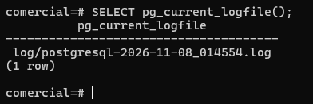
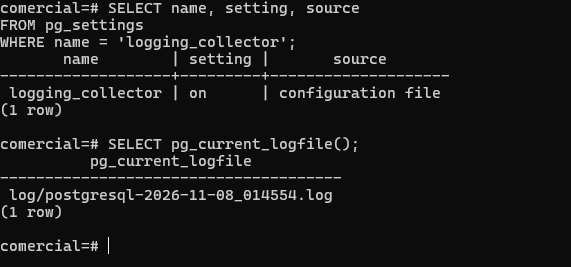

# Evidencia 02 — Colector de bitácora y vista `dba.bitacora`

## Objetivo

Que PostgreSQL administre sus propios archivos de bitácora (`logging_collector`) y poder
consultarlos con SQL mediante una vista de solo lectura. El script completo está en
`sql/01-colector-y-vista.sql`.

## Comandos ejecutados

```sql
-- 1. Activar el colector (requiere reinicio) y verificar que queda pendiente
ALTER SYSTEM SET logging_collector = on;

SELECT name, setting, pending_restart
FROM pg_settings
WHERE name = 'logging_collector';
```

```bash
# 2. Reinicio del servicio (ejemplo en Ubuntu; usa el comando que corresponda a tu instalación)
sudo systemctl restart postgresql@16-main
```

```sql
-- 3. Después del reinicio: origen del valor y archivo vigente
SELECT name, setting, source
FROM pg_settings
WHERE name = 'logging_collector';

SELECT pg_current_logfile();
```

Resultado obtenido:

```text
       name        | setting |       source
-------------------+---------+--------------------
 logging_collector | on      | configuration file

 pg_current_logfile
-------------------------------------
 log/postgresql-2026-11-08_014554.log
```





```sql
-- 4. Esquema, vista de solo lectura y pruebas
CREATE SCHEMA dba;
REVOKE ALL ON SCHEMA dba FROM PUBLIC;

CREATE VIEW dba.bitacora AS
SELECT t.n AS num, t.linea
FROM regexp_split_to_table(pg_read_file(pg_current_logfile()), E'\n')
     WITH ORDINALITY AS t(linea, n)
WHERE t.linea <> '';

SELECT num, linea FROM dba.bitacora ORDER BY num DESC LIMIT 10;   -- últimas 10 líneas
SELECT linea FROM dba.bitacora WHERE linea ILIKE '%update%';       -- búsqueda ILIKE
SELECT linea FROM dba.bitacora WHERE linea ~ '(FATAL|ERROR)';      -- expresión regular
```

> `WITH ORDINALITY` numera cada línea y `WHERE linea <> ''` descarta las vacías. La vista solo
> lee el archivo **vigente**; `pg_ls_logdir()` lista todos los archivos si se necesita el historial.

## Preguntas

**1. ¿Por qué `logging_collector` requiere reinicio y `log_statement` solo recarga?**
`logging_collector` decide si el *postmaster* arranca un proceso auxiliar (el *logging collector*)
y redirige `stderr` de todos los procesos hacia él mediante una tubería. Esa estructura se crea
una sola vez al arrancar el servidor, por lo que el parámetro tiene contexto `postmaster` y
solo se aplica al reiniciar (`pending_restart = true` hasta entonces). `log_statement`, en
cambio, solo es una condición que cada proceso consulta al ejecutar una sentencia (contexto
`superuser`), así que basta con `pg_reload_conf()` para que los procesos lean el nuevo valor.

**2. ¿Qué ventaja tiene leer la bitácora con SQL frente a las herramientas del sistema y qué riesgo introduce?**
*Ventaja:* se puede filtrar, contar y agrupar con SQL (`ILIKE`, expresiones regulares,
`GROUP BY`), unirla con otras tablas y hacerlo sin acceso al shell del servidor.
*Riesgo:* se concentra evidencia sensible en un objeto de la base. Quien tenga `SELECT` sobre la
vista (y permisos de `pg_read_file`, normalmente `pg_read_server_files`/superusuario) lee
contraseñas filtradas en sentencias, IP, nombres de usuarios, etc. Además, la consulta a la
vista también queda registrada y la lectura cuesta (relee el archivo completo en cada consulta).

**3. ¿Quién debería poder consultar `dba.bitacora`?**
Solo el rol DBA o de seguridad/auditoría. Por eso el esquema `dba` se crea con
`REVOKE ALL ... FROM PUBLIC` y no se otorga `USAGE`/`SELECT` a `app_ventas` ni a `soporte_ana`.
Aplica el mínimo privilegio de la Unidad II: quien administra datos no debería ser el único que
audita, y las aplicaciones nunca deben leer la bitácora.
