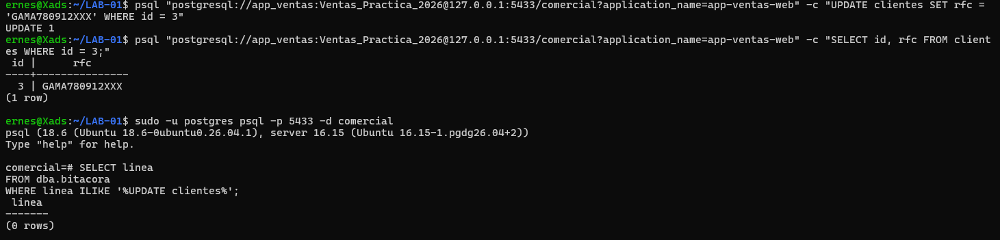

# Evidencia 03 — El incidente sin bitácora

## Reproducción del incidente

Desde la terminal, conectado como `app_ventas` con `application_name=app-ventas-web`:

```bash
psql "postgresql://app_ventas:<contraseña>@127.0.0.1:5433/comercial?application_name=app-ventas-web" \
  -c "UPDATE clientes SET rfc = 'GAMA780912XXX' WHERE id = 3"
# UPDATE 1
```

Búsqueda de rastros desde la sesión de administrador:

```sql
SELECT linea
FROM dba.bitacora
WHERE linea ILIKE '%UPDATE clientes%';
-- (0 rows)

SELECT linea
FROM dba.bitacora
WHERE linea ILIKE '%app_ventas%';
-- (0 rows)
```



La captura muestra `UPDATE 1` y `(0 rows)`: el cambio ocurrió, pero ni la sentencia ni la
conexión de `app_ventas` aparecen en la bitácora.

## Preguntas

**1. ¿Puedes demostrar quién modificó el RFC?**
No. El `UPDATE` se aplicó (`UPDATE 1`, y el `SELECT` posterior muestra `GAMA780912XXX`), pero
la bitácora no tiene la sentencia, la conexión, el usuario ni la hora. Solo se puede ver el
estado actual del dato, no quién ni cuándo lo cambió.

**2. ¿Puedes demostrar que no lo hizo `soporte_ana`?**
No con evidencia. Solo existe una inferencia: según los privilegios de la Unidad II,
`soporte_ana` tiene únicamente `SELECT` y no debería poder ejecutar un `UPDATE`. Pero eso es
una regla de diseño, no una prueba: otro rol con permiso, un cambio de privilegios previo o el
uso de credenciales ajenas darían el mismo resultado y no habría forma de descartarlo.

**3. ¿Los privilegios de la Unidad II impidieron el cambio? ¿Debían impedirlo?**
No lo impidieron y no debían hacerlo: `app_ventas` tiene `SELECT` y `UPDATE` sobre `clientes`
porque su función lo exige, así que el cambio fue autorizado. Los privilegios sí debían impedir
que `soporte_ana` modificara datos. Los privilegios responden a *quién puede hacer qué*, no a
*quién lo hizo*: controlan, pero no dejan rastro.

**4. ¿Qué tendría que haber estado configurado antes del incidente?**
La auditoría no es retroactiva: lo que no se registró en su momento no se puede reconstruir.
Debía estar activo desde antes:

- `logging_collector = on` (archivos administrados por el servidor y consultables).
- `log_connections = on` y `log_disconnections = on`.
- `log_line_prefix` con usuario, base de datos, aplicación, cliente y hora
  (`%m [%p] user=%u db=%d app=%a client=%h `).
- `log_statement = 'mod'` (o superior) para registrar `UPDATE`, `INSERT` y `DELETE`.
