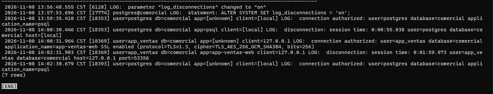

Script: `sql/02-configuracion-bitacora.sql`.

## Comandos ejecutados

```sql
ALTER SYSTEM SET log_connections    = on;
ALTER SYSTEM SET log_disconnections = on;
ALTER SYSTEM SET log_line_prefix    = '%m [%p] user=%u db=%d app=%a client=%h ';
ALTER SYSTEM SET log_statement      = 'ddl';
SELECT pg_reload_conf();
```

> La recarga es asíncrona: si se consulta `pg_settings` en el mismo bloque puede verse todavía el
> valor anterior. La verificación se hace en una consulta nueva:

```sql
SELECT name, setting, source, sourcefile, sourceline
FROM pg_settings
WHERE name IN ('log_connections','log_disconnections','log_line_prefix','log_statement');
```

Todos los valores aparecen con `source = configuration file` y
`sourcefile = /var/lib/postgresql/16/main/postgresql.auto.conf`, que es donde `ALTER SYSTEM`
guarda los cambios (en esta instancia `log_statement` quedó en la línea 7).

## Últimas líneas de la bitácora

```sql
SELECT num, linea FROM dba.bitacora ORDER BY num DESC LIMIT 10;
```

Líneas relevantes observadas:

```text
13:57:50.558 CST [17774] postgres@comercial LOG:  statement: ALTER SYSTEM SET log_connections = 'on';
13:57:53.696 CST [17774] postgres@comercial LOG:  statement: ALTER SYSTEM SET log_disconnections = 'on';
13:57:56.193 CST [17774] postgres@comercial LOG:  statement: ALTER SYSTEM SET log_line_prefix = '%m [%p] user=%u db=%d app=%a client=%h ';
13:56:48.555 CST [6128] LOG:  parameter "log_disconnections" changed to "on"
```



Se ve que las sentencias `ALTER SYSTEM` salen con el PID de la sesión del administrador
(`[17774]`, con el prefijo anterior `postgres@comercial`), mientras que el mensaje
`parameter "..." changed to "on"` sale con el PID `6128`, que es el del proceso principal
(*postmaster*). También se observa que la propia sesión de administración y sus consultas a
`dba.bitacora` quedan registradas: consultar la bitácora también deja rastro.

## Análisis

La recarga de configuración queda en la bitácora y la nueva configuración se aplica sin
reiniciar. Pero registrar el cambio no equivale a saber quién lo hizo con certeza: el mensaje
de `parameter ... changed` lo emite el proceso principal sin indicar qué usuario lo provocó, y la
sentencia solo se ve si `log_statement` ya la cubría en ese momento. Quien puede ejecutar
`ALTER SYSTEM` puede reducir la evidencia futura, por eso hay que limitar el superusuario,
conservar copias de la bitácora fuera del alcance de los administradores de la base y tener la
auditoría activa antes de que ocurra un incidente.

## Preguntas

**1. ¿Por qué el proceso que registra el cambio es el principal y no tu sesión?**
`ALTER SYSTEM` solo escribe `postgresql.auto.conf`; el cambio realmente se aplica cuando el
*postmaster* recibe `SIGHUP` (por `pg_reload_conf()`), relee los archivos de configuración y
propaga los nuevos valores a los procesos hijo. Quien detecta y registra
`parameter "x" changed to "y"` es el proceso que relee la configuración, es decir, el principal
(PID `6128` en esta instancia), no la sesión del administrador (PID `17774`/`18393`).

**2. ¿Qué pasaría si alguien ejecutara `ALTER SYSTEM SET log_statement = 'none'`? ¿Quedaría rastro?**
Sí, pero limitado. Mientras `log_statement` valga `ddl` o `mod`, la propia sentencia
`ALTER SYSTEM SET log_statement = 'none'` se registra (con usuario, hora y PID) porque la línea
se escribe antes de que el cambio surta efecto, y después de recargar el postmaster registra
`parameter "log_statement" changed to "none"`. También queda el valor en
`postgresql.auto.conf`. A partir de la recarga dejaría de registrarse todo lo que hiciera
esa persona, y si además borra o edita la bitácora o el archivo, el rastro desaparece:
de ahí la necesidad de enviar la bitácora a un destino externo.

**3. ¿Por qué no se recomienda editar `postgresql.auto.conf` a mano?**
Porque lo gestiona PostgreSQL: `ALTER SYSTEM` reescribe el archivo completo y puede pisar lo
editado, y una edición manual evita la validación del parámetro (un valor inválido puede impedir
el arranque o la recarga) y no deja la sentencia en la bitácora. Para cambios manuales se usa
`postgresql.conf` o un archivo en `conf.d`.
