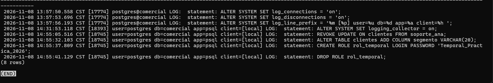

# Evidencia 06 — Cambios de privilegios y de estructura

Script: `sql/03-privilegios-estructura.sql`.

## Comandos ejecutados (como administrador, con `log_statement = 'ddl'`)

```sql
REVOKE UPDATE ON clientes FROM soporte_ana;
GRANT  UPDATE ON clientes TO app_ventas;
ALTER TABLE clientes ADD COLUMN segmento VARCHAR(20);

CREATE ROLE rol_temporal LOGIN PASSWORD 'Temporal_Practica_2026';
DROP ROLE rol_temporal;

SELECT linea FROM dba.bitacora WHERE linea LIKE '%statement:%' ORDER BY num;
```

## Resultado en la bitácora

```text
14:31:53.118 CST [18393] user=postgres db=comercial app=psql client=[local] LOG:  statement: ALTER SYSTEM SET logging_collector = on;
14:55:05.516 CST [18745] user=postgres db=comercial app=psql client=[local] LOG:  statement: REVOKE UPDATE ON clientes FROM soporte_ana;
14:55:32.103 CST [18745] user=postgres db=comercial app=psql client=[local] LOG:  statement: ALTER TABLE clientes ADD COLUMN segmento VARCHAR(20);
14:55:37.809 CST [18745] user=postgres db=comercial app=psql client=[local] LOG:  statement: CREATE ROLE rol_temporal LOGIN PASSWORD 'Temporal_Practica_2026';
14:55:41.129 CST [18745] user=postgres db=comercial app=psql client=[local] LOG:  statement: DROP ROLE rol_temporal;
```


### Hallazgo: la bitácora filtra un secreto

La línea de `CREATE ROLE` guarda la contraseña **en texto plano** (`Temporal_Practica_2026`),
aunque en la base se almacene como hash SCRAM. Con `log_statement` en `ddl`, `mod` o `all`,
cualquier sentencia con una contraseña literal (`CREATE ROLE ... PASSWORD`, `ALTER ROLE ...
PASSWORD`) deja ese secreto en el archivo. Mitigaciones: crear el rol sin contraseña y asignarla
con `\password` de `psql` (que la cifra en el cliente), restringir la lectura de la bitácora y
rotar las contraseñas que hayan quedado expuestas (la de este rol de práctica se debe tratar
como comprometida).

## Preguntas

**1. ¿Qué tipo de evento es cada una de las tres primeras sentencias (privilegio o estructura)?**

- `REVOKE UPDATE ... FROM soporte_ana`: **privilegio**, retira un permiso.
- `GRANT UPDATE ... TO app_ventas`: **privilegio**, concede un permiso.
- `ALTER TABLE ... ADD COLUMN segmento`: **estructura**, cambia la definición de la tabla.

(`CREATE ROLE` y `DROP ROLE` también son cambios de identidades/privilegios; aquí se usan para
mostrar la fuga de la contraseña.)

**2. ¿Por qué `GRANT` y `REVOKE` quedan registrados con `log_statement = 'ddl'`?**
Porque PostgreSQL incluye en la clase `ddl` todos los comandos que cambian el catálogo del
sistema: `CREATE`, `ALTER`, `DROP` y también `GRANT`, `REVOKE` (y `COMMENT`, `SECURITY LABEL`,
`CREATE TABLE AS`, etc.). Un `GRANT` modifica la ACL del objeto en el catálogo, así que se
trata como definición, aunque no cambie las columnas de la tabla.

**3. Si la bitácora contiene contraseñas, ¿quién debería poder leerla? Relaciónalo con la gestión de secretos de la Unidad II.**
Solo el personal autorizado de administración o seguridad (permisos del sistema operativo sobre
el archivo y, en SQL, acceso a `dba.bitacora` únicamente para el rol DBA/auditoría), nunca las
aplicaciones ni los usuarios finales. La bitácora se vuelve un almacén de secretos igual que un
archivo `.env` o un volcado de configuración, así que le aplican las mismas reglas de la
Unidad II: mínimo privilegio, no escribir secretos en texto plano, rotarlos si se exponen y
tratar la bitácora como dato sensible (cifrado, retención limitada).

## Análisis

Se distinguieron los eventos de privilegios (`GRANT`, `REVOKE`) de los de estructura (`ALTER
TABLE`) y se comprobó que todos quedan registrados con `log_statement = 'ddl'`, junto con el
usuario, la hora, la aplicación y el cliente. También se comprobó que la auditoría tiene un
costo de seguridad: la propia bitácora puede filtrar secretos, de modo que auditar incluye
proteger lo que se audita.
