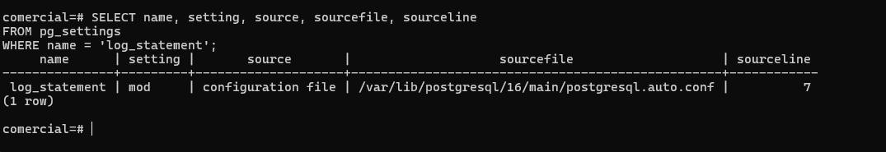

# Evidencia 07 — Modificaciones de datos: `ddl` frente a `mod`

## Objetivo

Comparar qué registra `log_statement = 'ddl'` y qué agrega `'mod'` cuando se modifican datos.

## 1. Con `log_statement = 'ddl'`

Como `app_ventas`:

```sql
UPDATE clientes SET rfc = 'GAMA780912XYZ' WHERE id = 3;   -- UPDATE 1
```

Con `ddl` solo se registran `CREATE`, `ALTER`, `DROP`, `GRANT`, `REVOKE`, etc. El `UPDATE`
se ejecutó pero **no** aparece en la bitácora:

```sql
SELECT linea FROM dba.bitacora WHERE linea ILIKE '%UPDATE clientes%';   -- sin la sentencia
```

## 2. Cambio a `mod`

```sql
ALTER SYSTEM SET log_statement = 'mod';
SELECT pg_reload_conf();

SELECT name, setting, source, sourcefile, sourceline
FROM pg_settings
WHERE name = 'log_statement';
```

```text
     name      | setting |       source       |                 sourcefile                  | sourceline
---------------+---------+--------------------+---------------------------------------------+-----------
 log_statement | mod     | configuration file | /var/lib/postgresql/16/main/postgresql.auto.conf |          7
```



`mod` registra todo lo de `ddl` más `INSERT`, `UPDATE`, `DELETE`, `TRUNCATE` y `COPY FROM`.

## 3. Con `log_statement = 'mod'`

```sql
UPDATE clientes SET telefono = '6679990000' WHERE id = 3;   -- UPDATE 1

SELECT nombre, rfc FROM clientes WHERE id = 3;               -- rfc = GAMA780912XYZ

SELECT linea FROM dba.bitacora WHERE linea ILIKE '%UPDATE clientes%' ORDER BY num;
```

Ahora la bitácora debe mostrar una línea del estilo:

```text
... user=app_ventas db=comercial app=app-ventas-web client=127.0.0.1 LOG:  statement: UPDATE clientes SET telefono = '6679990000' WHERE id = 3;
```

## Preguntas

**1. ¿Qué nivel habría registrado la lectura del RFC? ¿Qué costo tendría en un servidor con miles de consultas por minuto?**
`log_statement = 'all'`, que registra también los `SELECT`. En un servidor con miles de
consultas por minuto genera un volumen enorme de bitácora: más escritura en disco y espacio,
sobrecarga de CPU/E/S en cada sentencia, rotación y retención costosas, mucho ruido que
dificulta encontrar lo relevante, y más datos sensibles copiados en el archivo (los valores
literales de las consultas). Para auditar solo lecturas de columnas sensibles es mejor `pgaudit`
(Parte C opcional) que `all`.

**2. ¿Qué le falta a esta bitácora para revertir el cambio con certeza?**
Le falta el **valor anterior**: solo contiene el texto de la sentencia con el valor nuevo (y
solo si el `UPDATE` indicó los literales), no el estado de la fila antes del cambio. Tampoco
identifica la fila de forma unívoca cuando el `WHERE` es ambiguo, ni qué columnas cambiaron
realmente, ni garantiza el orden de varias sentencias. Para revertir con certeza se necesita
un registro por fila con `OLD` y `NEW`, usuario, hora y operación: el *trigger* de auditoría
de la Parte B.
