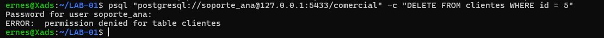
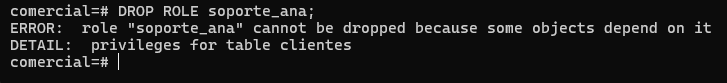

# Evidencia 08 — Errores y operaciones rechazadas

## Objetivo

Observar qué deja la bitácora cuando una operación es **rechazada**: un intento sin permiso y
una operación administrativa que PostgreSQL no permite.

## Pruebas ejecutadas

### 1. `soporte_ana` intenta borrar un cliente (solo tiene `SELECT`)

```bash
psql "postgresql://soporte_ana@127.0.0.1:5433/comercial" -c "DELETE FROM clientes WHERE id = 5"
```

```text
ERROR:  permission denied for table clientes
```



### 2. Borrar un rol que todavía tiene privilegios

```sql
DROP ROLE soporte_ana;
```

```text
ERROR:  role "soporte_ana" cannot be dropped because some objects depend on it
DETAIL:  privileges for table clientes
```



### 3. Revisión en la bitácora

```sql
SELECT num, linea
FROM dba.bitacora
WHERE linea ~ '(ERROR|STATEMENT)'
ORDER BY num DESC
LIMIT 10;
```

Cada error genera un par de líneas: la línea `ERROR` (con el usuario, la base, la aplicación y el
cliente del prefijo) y la línea `STATEMENT` con la sentencia que lo causó, porque
`log_min_error_statement = error`. Con `log_statement = 'mod'`, el `DELETE` además aparece
antes como `statement: DELETE FROM clientes WHERE id = 5;`, ya que se registra al recibirse,
no al terminar.

## Análisis

- Un error de permisos es evidencia de **intento**, no de cambio: los datos no se alteraron
  (`DELETE` no se ejecutó), pero queda registrado quién lo intentó, desde dónde y cuándo.
- La bitácora distingue lo ocurrido de lo rechazado: una operación exitosa solo se ve si
  `log_statement` la cubre, mientras que una fallida se ve **siempre** gracias a `ERROR` y
  `log_min_error_statement`, aun con `log_statement = 'none'`.
- Una sucesión de `permission denied` del mismo usuario puede indicar un error de configuración
  de la aplicación o exploración de privilegios, por lo que conviene vigilarla.
- El `DROP ROLE` fallido muestra que los privilegios otorgados (Unidad II) crean dependencias:
  antes de eliminar un rol hay que retirar sus privilegios (`REVOKE`) o reasignar objetos
  (`REASSIGN OWNED` / `DROP OWNED`). Esto importa para auditoría porque el rol
  responsable de una acción pasada no debería desaparecer sin conservar su rastro.
