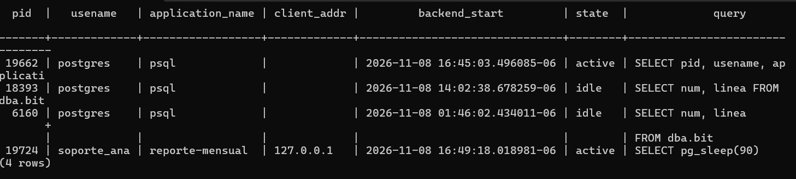
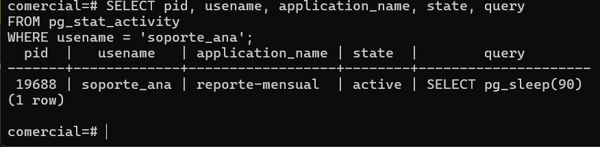

# Evidencia 09 — Sesiones activas con `pg_stat_activity`

## Objetivo

Contrastar el **estado actual** del servidor (`pg_stat_activity`) con el **historial** que da la
bitácora.

## Sesión de larga duración

Desde otra terminal, `soporte_ana` mantiene una consulta ejecutándose 90 segundos:

```bash
psql "postgresql://soporte_ana@127.0.0.1:5433/comercial?application_name=reporte-mensual" \
     -c "SELECT pg_sleep(90)"
```

Mientras corre, el administrador consulta:

```sql
SELECT pid, usename, application_name, client_addr, backend_start, state, query
FROM pg_stat_activity
WHERE usename IS NOT NULL;
```

Resultado (ver captura):

```text
  pid  |   usename   | application_name | client_addr |        backend_start          | state  | query
-------+-------------+------------------+-------------+-------------------------------+--------+----------------------------
 19662 | postgres    | psql             |             | 2026-11-08 16:45:03.496085-06 | active | SELECT pid, usename, ...
 18393 | postgres    | psql             |             | 2026-11-08 14:02:38.678259-06 | idle   | SELECT num, linea FROM dba.bit...
  6160 | postgres    | psql             |             | 2026-11-08 01:46:02.434011-06 | idle   | SELECT num, linea FROM dba.bit...
 19724 | soporte_ana | reporte-mensual  | 127.0.0.1   | 2026-11-08 16:49:18.018981-06 | active | SELECT pg_sleep(90)
(4 rows)
```



Filtrando solo la sesión de `soporte_ana`:

```sql
SELECT pid, usename, application_name, state, query
FROM pg_stat_activity
WHERE usename = 'soporte_ana';
```

```text
  pid  |   usename   | application_name | state  |        query
-------+-------------+------------------+--------+---------------------
 19688 | soporte_ana | reporte-mensual  | active | SELECT pg_sleep(90)
(1 row)
```



> Nota: los PID de las dos capturas (`19724` y `19688`) corresponden a dos ejecuciones distintas
> del `pg_sleep(90)`; cada conexión nueva recibe un PID nuevo.

## Análisis: `pg_stat_activity` frente a la bitácora

| Aspecto | `pg_stat_activity` | Bitácora (`dba.bitacora`) |
| --- | --- | --- |
| Tiempo | **Ahora**: solo sesiones abiertas | **Historia**: lo ocurrido, incluso de sesiones ya cerradas |
| Consulta en curso | Sí (`query`, `state`, `backend_start`) | Solo si `log_statement` la cubre, y al inicio |
| Conexiones fallidas | No aparecen (nunca llegaron a existir) | Sí (`FATAL`) |
| Persistencia | Se pierde al cerrar la sesión o reiniciar | Queda en archivo, rotada y conservable |
| Uso típico | Ver quién está conectado, detectar consultas largas o bloqueos | Reconstruir un incidente y atribuir responsabilidad |

Con la captura se puede identificar de inmediato **quién** (`soporte_ana`), **desde dónde**
(`127.0.0.1`), **con qué aplicación** (`reporte-mensual`), **desde cuándo** (`backend_start`)
y **qué ejecuta** (`pg_sleep(90)`). Pero cuando la consulta termina y la sesión se cierra, esa
información desaparece de la vista: solo la bitácora (con `log_connections`/`log_disconnections`)
conserva el registro. Son complementarias: una muestra el presente y la otra el pasado.

## Notas

- Con `pid` se puede cancelar la consulta (`pg_cancel_backend(pid)`) o cerrar la sesión
  (`pg_terminate_backend(pid)`); ambas acciones requieren privilegios y conviene registrar
  quién las ejecutó.
- La columna `query` de otros usuarios solo es visible para superusuarios o miembros de
  `pg_read_all_stats`; un usuario común solo ve sus propias sesiones completas.
