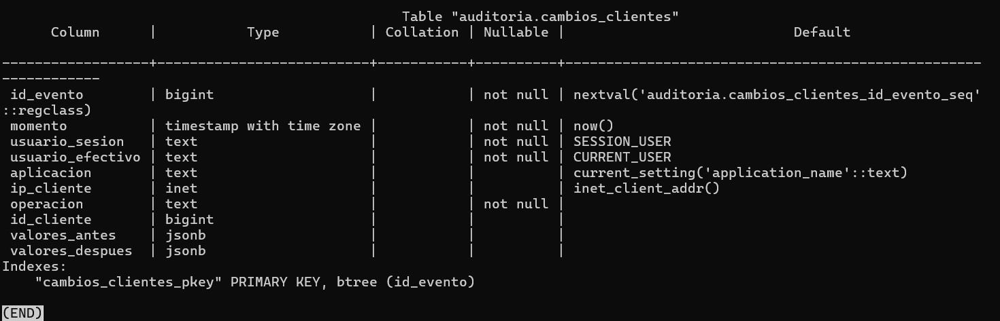

# Evidencia 10 — Diseño y creación del registro de auditoría

Script: `sql/04-esquema-auditoria.sql`.

## Diseño de los campos

Las preguntas de Dirección son: **¿quién?, ¿cuándo?, ¿desde dónde?, ¿qué cambió? y ¿cuál era el valor anterior?**

| Campo | Tipo | ¿Qué pregunta responde? | ¿Puede ser nulo? ¿Por qué? |
| --- | --- | --- | --- |
| `id_evento` | BIGSERIAL | Identifica cada evento y fija su orden; permite detectar huecos (borrados) en la secuencia. | No: es clave primaria. |
| `momento` | TIMESTAMPTZ | **¿Cuándo?** | No: un evento sin hora no sirve para una cronología. Se llena con `now()`. |
| `usuario_sesion` | TEXT | **¿Quién?** Rol con el que se autenticó la conexión (`session_user`); no cambia con `SET ROLE`. | No: siempre existe una sesión. |
| `usuario_efectivo` | TEXT | **¿Quién?** Rol con el que se ejecutó (`current_user`); distingue si hubo `SET ROLE` o `SECURITY DEFINER`. | No: siempre hay un rol efectivo. |
| `aplicacion` | TEXT | **¿Desde dónde?** `application_name` (p. ej. `app-ventas-web`). | Sí: el cliente puede no declararlo (vacío). |
| `ip_cliente` | INET | **¿Desde dónde?** Dirección del cliente. | Sí: en conexiones por socket local `inet_client_addr()` devuelve NULL. |
| `operacion` | TEXT | **¿Qué cambió?** `INSERT`, `UPDATE` o `DELETE`. | No: todo evento es de algún tipo. |
| `id_cliente` | BIGINT | **¿Qué cambió?** Fila afectada. | Sí: por si la auditoría se extiende a operaciones sin una fila concreta (p. ej. `TRUNCATE`). |
| `valores_antes` | JSONB | **¿Cuál era el valor anterior?** | Sí: en un `INSERT` no existía fila previa. |
| `valores_despues` | JSONB | **¿Qué cambió?** Estado resultante. | Sí: en un `DELETE` no queda fila posterior. |

## Creación

```sql
CREATE SCHEMA auditoria;
REVOKE ALL ON SCHEMA auditoria FROM PUBLIC;

CREATE TABLE auditoria.cambios_clientes (
    id_evento        BIGSERIAL PRIMARY KEY,
    momento          TIMESTAMPTZ NOT NULL DEFAULT now(),
    usuario_sesion   TEXT        NOT NULL DEFAULT session_user,
    usuario_efectivo TEXT        NOT NULL DEFAULT current_user,
    aplicacion       TEXT        DEFAULT current_setting('application_name'),
    ip_cliente       INET        DEFAULT inet_client_addr(),
    operacion        TEXT        NOT NULL,
    id_cliente       BIGINT,
    valores_antes    JSONB,
    valores_despues  JSONB
);
```

Los valores por defecto capturan el contexto de la sesión en el momento de insertar cada registro.



## Preguntas

**1. ¿Por qué `momento` usa `TIMESTAMPTZ` y no `TIMESTAMP`?**
`TIMESTAMPTZ` guarda un instante absoluto (internamente en UTC) y lo muestra en la zona de la
sesión, así que dos eventos se pueden ordenar y comparar sin ambigüedad aunque cambien la zona
horaria, el horario de verano o el servidor. `TIMESTAMP` no guarda zona: la hora `14:00` puede
significar cosas distintas y rompe la cronología al combinar fuentes (bitácora en CST, aplicación
en UTC, etc.).

**2. ¿Por qué se guarda el registro completo en `JSONB` y no solo la columna que cambió?**
Porque conserva el estado completo de la fila y da contexto para revertir o investigar (se ve
también lo que **no** cambió). Es independiente de la estructura: si `clientes` gana, pierde o
renombra columnas después (p. ej. `segmento`), los eventos antiguos siguen siendo válidos sin
migrar la tabla de auditoría. Además el mismo trigger sirve para cualquier columna y evita
omitir una por error. El costo es más espacio.

**3. La tabla de auditoría también contendrá RFC. ¿Qué implica eso para su clasificación y su control de acceso?**
Contiene datos personales (RFC, nombre, teléfono) duplicados, por lo que **hereda la
clasificación de `clientes`** (confidencial/personal) y, de hecho, es más sensible porque guarda
también valores históricos que ya no están en la tabla original. Implica: esquema separado y sin
acceso público (`REVOKE ALL ... FROM PUBLIC`); lectura solo para auditoría/DBA y sin permiso de
`UPDATE`/`DELETE` ni siquiera para quien escribe; que solo el disparador (`SECURITY DEFINER`)
inserte; cifrado y respaldos con el mismo nivel de protección; y una política de retención
(no conservar datos personales indefinidamente).
