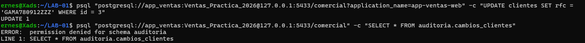
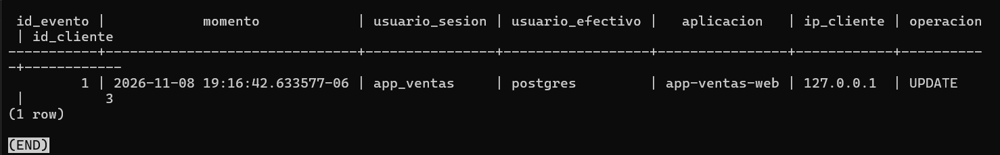
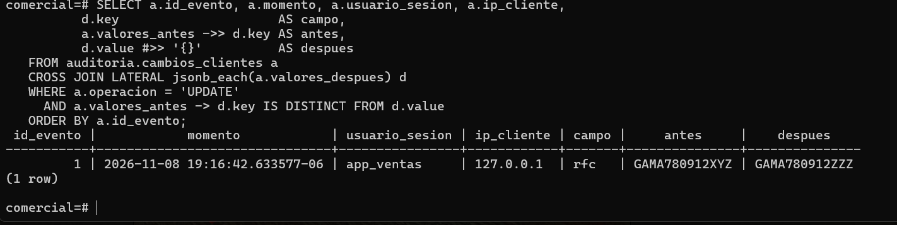

# Evidencia 11 — El incidente auditado

Script: `sql/06-campos-modificados.sql`.

## 1. La aplicación cambia el RFC e intenta leer la auditoría

```bash
psql "postgresql://app_ventas:<contraseña>@127.0.0.1:5433/comercial?application_name=app-ventas-web" \
  -c "UPDATE clientes SET rfc = 'GAMA780912ZZZ' WHERE id = 3"
psql "postgresql://app_ventas:<contraseña>@127.0.0.1:5433/comercial" \
  -c "SELECT * FROM auditoria.cambios_clientes"
```

```text
UPDATE 1
ERROR:  permission denied for schema auditoria
```



`app_ventas` modifica el dato, pero no puede leer ni alterar la auditoría.

## 2. Lo que registró el disparador (sesión de administrador)

```sql
\x
SELECT id_evento, momento, usuario_sesion, usuario_efectivo, aplicacion, ip_cliente, operacion, id_cliente
FROM auditoria.cambios_clientes ORDER BY id_evento;
\x
```



`usuario_efectivo` es `postgres` porque dentro de una función `SECURITY DEFINER`, `current_user`
es el propietario de la función. Por eso se guarda también `session_user`: si la auditoría solo
usara `current_user`, todos los cambios parecerían hechos por `postgres`.

## 3. ¿Qué campo cambió?

```sql
SELECT a.id_evento, a.momento, a.usuario_sesion, a.ip_cliente,
       d.key                     AS campo,
       a.valores_antes ->> d.key AS antes,
       d.value #>> '{}'          AS despues
FROM auditoria.cambios_clientes a
CROSS JOIN LATERAL jsonb_each(a.valores_despues) d
WHERE a.operacion = 'UPDATE'
  AND a.valores_antes -> d.key IS DISTINCT FROM d.value
ORDER BY a.id_evento;
```

```text
 id_evento | momento | usuario_sesion | ip_cliente | campo | antes         | despues
-----------+---------+----------------+------------+-------+---------------+--------------
 1 | 2026-11-08 19:16:42.633577-06  app_ventas     | rfc   | GAMA780912XYZ | GAMA780912ZZZ
```



| Parte | Qué hace |
| --- | --- |
| `jsonb_each(a.valores_despues)` | Convierte el documento en filas clave/valor, una por campo |
| `CROSS JOIN LATERAL` | Aplica esa función a cada fila de auditoría |
| `->>` / `#>> '{}'` | Extraen el valor como texto |
| `IS DISTINCT FROM` | Compara tratando correctamente los nulos |

## Preguntas

**1. Compara tu hipótesis de la Actividad 11 con este resultado.**
La hipótesis fue que sin `SECURITY DEFINER` el `INSERT` de auditoría fallaría porque
`app_ventas` no tiene permisos sobre el esquema `auditoria`, y con ello fallaría el `UPDATE`.
El resultado la respalda: `app_ventas` no puede ni leer el esquema (`permission denied for
schema auditoria`), y aun así el evento quedó registrado y el `UPDATE` tuvo éxito. Eso solo es
posible porque la función se ejecuta con los privilegios de su propietario, como lo muestra
`usuario_efectivo = postgres`. Es decir, la función escribe donde la aplicación no puede.

**2. Escribe la sentencia `UPDATE` que restauraría el valor anterior.**

```sql
UPDATE clientes SET rfc = 'GAMA780912XYZ' WHERE id = 3;
```

Este cambio también quedará auditado como un nuevo evento. No se borra ni se edita el evento
original: la auditoría conserva el historial completo del cambio y de su reversión.

**3. ¿Qué columna conserva más valor para una investigación: `aplicacion` o `ip_cliente`? ¿Cuál puede falsificar el cliente con más facilidad?**
`ip_cliente` conserva más valor, porque la toma el servidor de la conexión real y sirve para
rastrear el origen (aunque puede ocultarse tras NAT, VPN o proxy). `aplicacion` es más fácil de
falsificar: `application_name` lo declara el propio cliente en la cadena de conexión y cualquiera
puede escribir `app-ventas-web`. Sirve para distinguir aplicaciones legítimas, pero no es
evidencia fuerte de identidad.