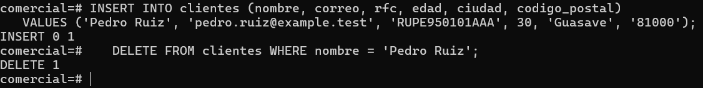
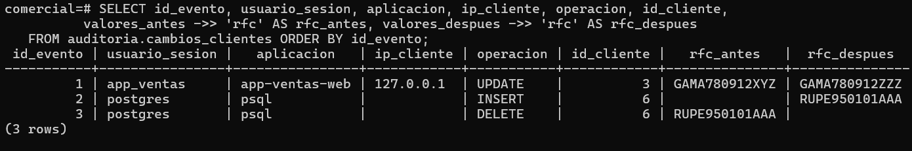

# Evidencia — Actividad 13: Altas y bajas

## Ejecución (como administrador)

```sql
INSERT INTO clientes (nombre, correo, rfc, edad, ciudad, codigo_postal)
VALUES ('Pedro Ruiz', 'pedro.ruiz@example.test', 'RUPE950101AAA', 30, 'Guasave', '81000');

DELETE FROM clientes WHERE nombre = 'Pedro Ruiz';
```



## Consulta de auditoría

```sql
SELECT id_evento, usuario_sesion, aplicacion, ip_cliente, operacion, id_cliente,
       valores_antes ->> 'rfc' AS rfc_antes, valores_despues ->> 'rfc' AS rfc_despues
FROM auditoria.cambios_clientes ORDER BY id_evento;
```



El `INSERT` guarda solo `valores_despues` (no existía fila previa) y el `DELETE` guarda solo
`valores_antes` (ya no queda fila posterior). La fila original del `UPDATE` de la Actividad 12
sigue en el historial.

## Preguntas

**1. El cliente `Pedro Ruiz` ya no existe en `clientes`. ¿Dónde queda evidencia de que existió y de sus datos?**
En `auditoria.cambios_clientes`: el evento `INSERT` guarda el registro completo en
`valores_despues` y el evento `DELETE` guarda el registro completo en `valores_antes`, con
`to_jsonb(OLD)`, además del usuario, la hora, la aplicación y el `id_cliente`. También queda
rastro de las sentencias en `dba.bitacora` mientras `log_statement` cubra `mod`, pero sin los
valores anteriores. Solo la auditoría permite reconstruir el registro borrado.

**2. ¿Por qué `ip_cliente` está vacía en los eventos 2 y 3?**
Porque el administrador se conectó con `psql` por el socket local de Unix
(`sudo -u postgres psql`), y en ese tipo de conexión `inet_client_addr()` devuelve `NULL`: no
hay dirección IP, solo un archivo de socket. En la bitácora aparece como `client=[local]`. En
una conexión por TCP (como la de `app_ventas` desde `127.0.0.1`) sí se registra la IP. Por eso
la columna se definió sin `NOT NULL`.

**3. La política de retención de la Unidad II pedía eliminar datos cuando ya no fueran necesarios. ¿Qué conflicto aparece? ¿Quién debe resolverlo?**
El conflicto es que la tabla `clientes` puede borrar a una persona, pero la tabla de auditoría
conserva sus datos personales (nombre, correo, RFC) en `valores_antes`/`valores_despues`, así
que el dato "eliminado" sigue existiendo. Hay dos obligaciones opuestas: minimizar y eliminar
datos personales cuando ya no son necesarios, y conservar evidencia íntegra para investigar. La
decisión no es técnica: la deben tomar los responsables de gobierno de datos junto con
Legal/Cumplimiento y Seguridad (y el dueño del dato). Deben fijar un plazo de retención de la
auditoría, qué campos se conservan o se enmascaran, cómo se atienden las solicitudes de
eliminación de los titulares y cómo se borra o anonimiza el historial al vencer el plazo. El DBA
ejecuta lo que se decida, no define la política.