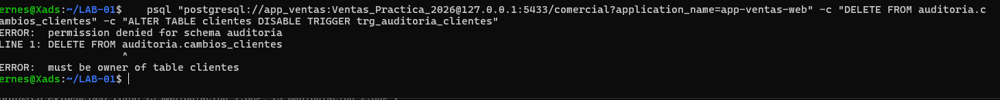
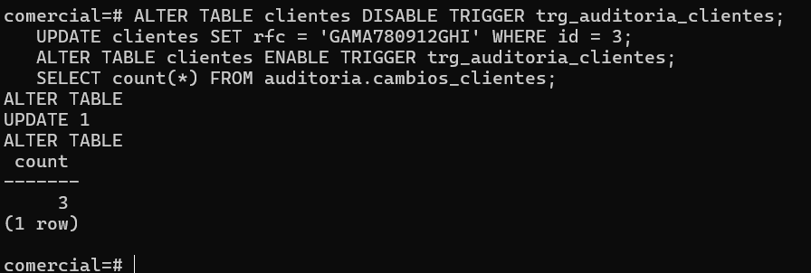
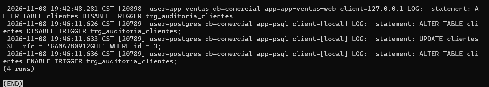

# Evidencia — Actividad 14: Intentar manipular la auditoría

## 1. Intento desde la cuenta de la aplicación

```bash
psql "postgresql://app_ventas:<contraseña>@127.0.0.1:5433/comercial?application_name=app-ventas-web" \
  -c "DELETE FROM auditoria.cambios_clientes" \
  -c "ALTER TABLE clientes DISABLE TRIGGER trg_auditoria_clientes"
```

```text
ERROR:  permission denied for schema auditoria
ERROR:  must be owner of table clientes
```



La aplicación no puede borrar la auditoría (no tiene acceso al esquema) ni desactivar el
disparador (no es propietaria de `clientes`). Los controles de privilegios sí detienen a un
usuario sin poder administrativo.

## 2. Desde la cuenta de administrador

```sql
ALTER TABLE clientes DISABLE TRIGGER trg_auditoria_clientes;
UPDATE clientes SET rfc = 'GAMA780912GHI' WHERE id = 3;
ALTER TABLE clientes ENABLE TRIGGER trg_auditoria_clientes;
SELECT count(*) FROM auditoria.cambios_clientes;
```



El conteo no aumentó: el cambio de RFC no quedó en la tabla de auditoría.

## 3. Lo que sí queda en la bitácora

```sql
SELECT linea FROM dba.bitacora
WHERE linea ~ 'statement: (ALTER TABLE clientes (DIS|EN)ABLE|UPDATE clientes SET rfc = .GAMA780912GHI)'
ORDER BY num;
```




La primera línea es el intento de `app_ventas`: la sentencia se registra al recibirse, antes de
ejecutarse, aunque después falle por falta de permisos.

## Qué protege cada mecanismo

```text
Tabla de auditoría      →  detalle del dato (antes y después)
                           la puede desactivar el propietario de la tabla
Bitácora del servidor   →  registra que el mecanismo se desactivó
                           la puede alterar quien controle el servidor
```

Ningún mecanismo dentro del propio servidor protege contra un administrador con control total.
Por eso se envían las bitácoras a un sistema externo administrado por otra área y se separa a
quien opera la base de quien custodia la evidencia.

## Preguntas

**1. ¿Qué evidencia permite detectar que hubo un cambio sin auditar?**
La bitácora del servidor. Contiene el `UPDATE clientes SET rfc = 'GAMA780912GHI' WHERE id = 3`
ejecutado por `postgres`, pero la tabla `auditoria.cambios_clientes` no tiene un evento
correspondiente (el conteo no cambió). Además, la bitácora muestra los
`ALTER TABLE ... DISABLE TRIGGER` y `ENABLE TRIGGER` alrededor del cambio, con usuario y hora.
Se detecta **cruzando** ambas fuentes: toda sentencia `INSERT/UPDATE/DELETE` sobre `clientes`
en la bitácora debe tener su evento de auditoría. Otra señal es que el RFC actual de la fila
(`GAMA780912GHI`) no coincide con `valores_despues` del último evento auditado de ese cliente
(`GAMA780912ZZZ`).

**2. ¿Qué control administrativo (no técnico) reduciría este riesgo?**
Separar funciones y exigir control sobre el cambio: que las bitácoras se envíen a un sistema
externo administrado por el área de Seguridad o Auditoría (no por el DBA); que desactivar un
disparador o cambiar la auditoría requiera un cambio formal autorizado por una segunda
persona (gestión de cambios con doble autorización); y que se revisen periódicamente las
bitácoras, cruzándolas con la tabla de auditoría, con consecuencias disciplinarias claras.

**3. Relaciona esta actividad con el principio de separación de funciones de la Unidad II.**
Quien opera la base de datos no debería ser quien custodia la evidencia de lo que hace. Aquí,
`app_ventas` quedó contenida por los privilegios (no es propietaria ni tiene acceso a la
auditoría), pero el administrador reunía todas las funciones: podía operar, desactivar el
mecanismo y modificar datos sin dejar detalle. La separación de funciones reparte esos poderes
entre personas o áreas distintas (operación, seguridad/auditoría, custodia de bitácoras) para
que nadie pueda cambiar los datos y borrar el rastro por sí solo.