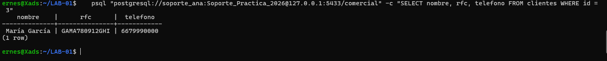
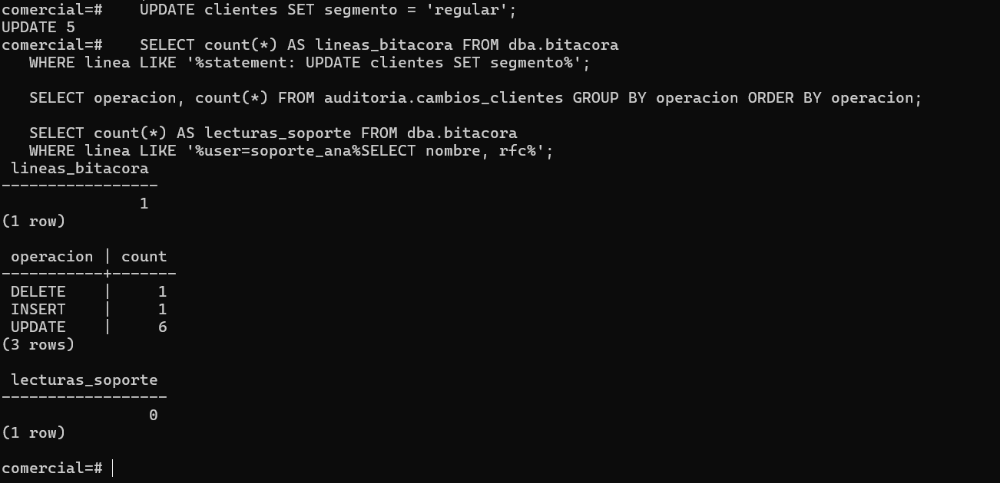

# Evidencia — Actividad 15: Límites, lecturas y volumen

## 1. Lectura de datos sensibles

```bash
psql "postgresql://soporte_ana:<contraseña>@127.0.0.1:5433/comercial" \
  -c "SELECT nombre, rfc, telefono FROM clientes WHERE id = 3"
```



## 2. Cambio masivo (como administrador)

```sql
UPDATE clientes SET segmento = 'regular';
```

```text
UPDATE 5
```

## 3. Qué registró cada mecanismo

```sql
SELECT count(*) AS lineas_bitacora FROM dba.bitacora
WHERE linea LIKE '%statement: UPDATE clientes SET segmento%';

SELECT operacion, count(*) FROM auditoria.cambios_clientes GROUP BY operacion ORDER BY operacion;

SELECT count(*) AS lecturas_soporte FROM dba.bitacora
WHERE linea LIKE '%user=soporte_ana%SELECT nombre, rfc%';
```

```text
  lineas_bitacora
-----------------
               1
(1 row)

 operacion | count
-----------+-------
 DELETE    |     1
 INSERT    |     1
 UPDATE    |     6
(3 rows)

 lecturas_soporte
------------------
                0
(1 row)
```



- El `UPDATE` masivo produjo **una** línea en la bitácora y **una fila de auditoría por cada fila
  afectada** (el disparador es `FOR EACH ROW`).
- La lectura del RFC por `soporte_ana` **no dejó rastro**: no existe disparador para `SELECT`
  y `log_statement = 'mod'` no registra consultas.

| Alternativa para registrar lecturas | Ventaja | Desventaja |
| --- | --- | --- |
| `log_statement = 'all'` | No requiere instalar nada | Registra todas las consultas de todas las tablas |
| Entregar el dato solo mediante una función que registre su uso | Control preciso | Requiere cambiar la aplicación |
| `pgaudit` con auditoría de objeto (Parte C) | Registra lecturas por tabla y por columna | Requiere instalar una extensión |

## Preguntas

**1. Si `clientes` tuviera un millón de registros, ¿qué ocurriría con la auditoría tras un `UPDATE` sin `WHERE`?**
El disparador por fila generaría un millón de eventos, cada uno con dos documentos JSON del
registro completo (`valores_antes` y `valores_despues`). La tabla de auditoría crecería de golpe
(gigabytes), el `UPDATE` tardaría mucho más porque cada fila hace un `INSERT` adicional, se
generaría mucho WAL y carga de escritura, y la consulta del incidente se volvería lenta y
difícil de revisar. La bitácora, en cambio, seguiría mostrando una sola línea. La auditoría
tendría el detalle completo, pero a un costo alto en rendimiento y almacenamiento; por eso
conviene particionar, definir retención y vigilar su tamaño.

**2. Propón quién podría autorizar la depuración de `auditoria.cambios_clientes`.**
No debe decidirla el DBA que opera la base. Propongo un comité o responsable de gobierno de
datos con Legal/Cumplimiento (por los plazos de retención y la protección de datos
personales) y Seguridad o Auditoría interna como custodio de la evidencia. El DBA solo ejecuta
la depuración con una solicitud de cambio aprobada por escrito y, de preferencia,
con doble autorización, dejando constancia de qué rango de eventos se eliminó y cuándo.

**3. ¿Por qué `log_statement = 'all'` puede convertir la bitácora en un nuevo depósito de datos sensibles?**
Porque registra el texto completo de cada sentencia, incluidos los valores literales: RFC,
nombres, teléfonos, contraseñas en `CREATE ROLE ... PASSWORD`, resultados de filtros
(`WHERE rfc = '...'`). La bitácora termina conteniendo una copia de los datos sensibles,
fuera de las tablas y de sus controles de acceso, en archivos de texto que se rotan, se copian a
respaldos y a sistemas externos y que mucha más gente puede leer. Si se activa, la bitácora debe
clasificarse y protegerse con el mismo nivel que los datos que contiene y con retención
limitada.