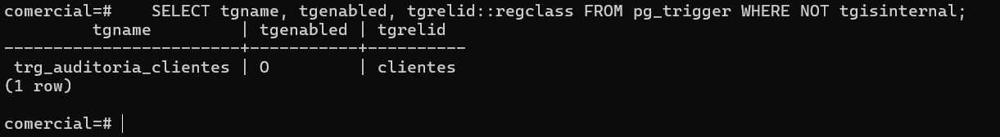
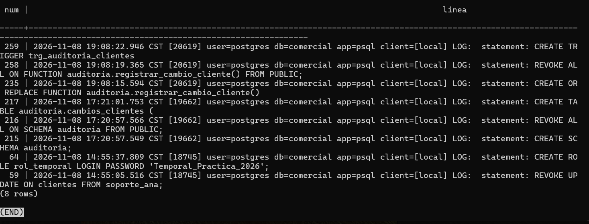

# Evidencia 11 — Función y disparador de auditoría

Script: `sql/05-funcion-disparador.sql`.

## Ejecución

Como administrador se creó la función `auditoria.registrar_cambio_cliente()` (`SECURITY DEFINER`,
`search_path` fijo), se le quitó el permiso a `PUBLIC` y se creó el disparador
`trg_auditoria_clientes`. Verificación:

```sql
SELECT tgname, tgenabled, tgrelid::regclass FROM pg_trigger WHERE NOT tgisinternal;
```

```text
         tgname         | tgenabled | tgrelid
------------------------+-----------+----------
 trg_auditoria_clientes | O         | clientes
```

`O` indica que el disparador está habilitado.



## Bitácora

```sql
SELECT num, linea FROM dba.bitacora
WHERE linea ~ 'statement: (CREATE|REVOKE)' ORDER BY num DESC LIMIT 10;
```



## Preguntas

**1. ¿Por qué se ejecuta `REVOKE ALL ON FUNCTION ... FROM PUBLIC` si el disparador seguirá funcionando para `app_ventas`?**
Porque PostgreSQL da `EXECUTE` a `PUBLIC` por defecto en toda función nueva, y esta es
`SECURITY DEFINER`: se ejecuta con los privilegios de su dueño, que puede escribir en el esquema
de auditoría. Quitar el permiso aplica el mínimo privilegio. El disparador sigue funcionando
porque lo ejecuta el motor al modificar `clientes`; el `EXECUTE` se verifica al crear el
disparador (lo hace el administrador), no cada vez que `app_ventas` hace un `UPDATE`.

**2. ¿Qué pasaría si la función no fuera `SECURITY DEFINER`? (hipótesis para la Actividad 12)**
La función correría con los privilegios de `app_ventas`, que no tiene `USAGE` sobre el esquema
`auditoria` ni `INSERT` sobre `cambios_clientes`. El `INSERT` de auditoría fallaría con
`permission denied for schema auditoria` y, como el disparador es parte de la sentencia, el
`UPDATE` completo se revertiría: la aplicación no podría modificar clientes. Dar a `app_ventas`
permisos sobre la tabla de auditoría le permitiría también alterar o borrar el rastro, lo que
anula la auditoría. Por eso la función es `SECURITY DEFINER`, con `search_path` fijo para evitar
el secuestro de objetos. Esta hipótesis se comprueba en la Actividad 12.

**3. Consulta `dba.bitacora`. ¿Quedó registrada la creación del esquema, la tabla, la función y el disparador? ¿Por qué?**
Sí. En este laboratorio `log_statement` quedó en `mod`, que incluye `ddl`, y `CREATE SCHEMA`,
`REVOKE`, `CREATE TABLE`, `CREATE FUNCTION` (con su cuerpo) y `CREATE TRIGGER` son sentencias de
definición. Quedan con usuario, hora, aplicación y cliente, y sirven de evidencia de quién
instaló el mecanismo de auditoría y cuándo.