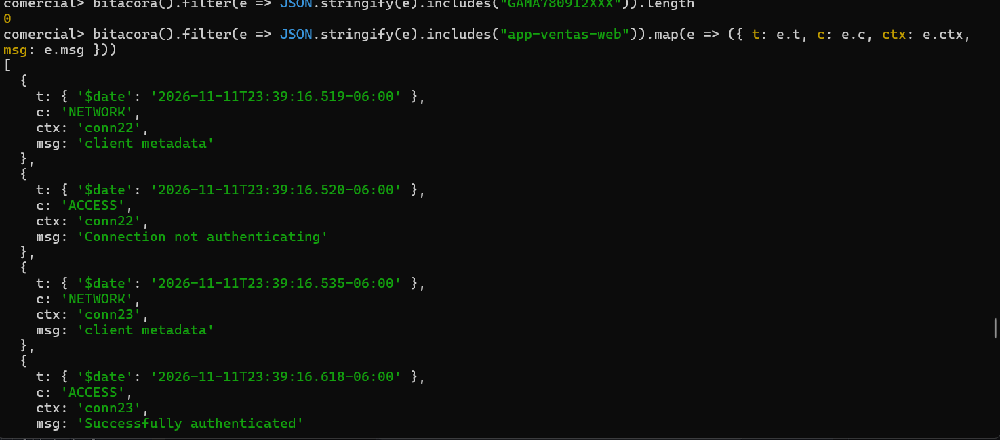

# Evidencia 02 — El incidente sin perfilado

**Actividad 2 · LAB-02**

## Comandos ejecutados

Sesión del DBA (estado del perfilador):

```js
db.getProfilingStatus()
```

Sesión de la aplicación (el cambio del RFC):

```bash
mongosh "mongodb://app_ventas:<REDACTED>@127.0.0.1:27017/comercial?appName=app-ventas-web" --quiet --eval 'db.clientes.updateOne({ _id: 3 }, { $set: { rfc: "GAMA780912XXX" } })'
```

Búsqueda de evidencia (sesión del DBA, con la función `bitacora()` definida):

```js
db.system.profile.countDocuments()
bitacora().filter(e => JSON.stringify(e).includes("GAMA780912XXX")).length
bitacora().filter(e => JSON.stringify(e).includes("app-ventas-web")).map(e => ({ t: e.t, c: e.c, ctx: e.ctx, msg: e.msg }))
```

## Resultado observado



- Búsqueda del valor `GAMA780912XXX` en la bitácora: **0** coincidencias (visible en la captura).
- El perfilador estaba apagado: el primer evento `Profiler settings changed` de la bitácora (2026-11-11 23:59:25.869, `conn43`) muestra `from: { level: 0 }`, es decir, el nivel era 0 en el momento del cambio.
- La bitácora sí muestra la **conexión y autenticación** de la aplicación. En `bitacora-mongod.log`, a las **23:39:16** (hora local) aparecen:

| Conexión | Evento | Detalle |
|---|---|---|
| `conn22` | `Connection not authenticating` | conexión sin autenticar (127.0.0.1:56274) |
| `conn23` | `Successfully authenticated` | `app_ventas`, SCRAM-SHA-256, appName `app-ventas-web` |
| `conn24`, `conn25`, `conn26` | `Successfully authenticated` | `app_ventas`, appName `app-ventas-web` |

## Respuestas

**1. ¿Puedes demostrar qué cambió? ¿Y quién se conectó a esa hora?**
- **Qué cambió: no.** No hay evidencia con esta edición: el perfilador estaba apagado y la bitácora no registra operaciones CRUD, solo conexiones y autenticaciones.
- **Quién se conectó: sí.** A las 23:39:16 el usuario `app_ventas` se autenticó desde `127.0.0.1` con la aplicación `app-ventas-web`. Eso es compatible con el cambio, pero **no lo demuestra**: una conexión no equivale a una operación.

**2. ¿Por qué `mongosh` abre varias conexiones (`conn22`, `conn23`, …) para una sola instrucción? ¿Cuál es la que se autentica?**
Una sola ejecución de `mongosh` abre varias conexiones: una inicial (`conn22`) que solo envía metadatos y queda como `Connection not authenticating`, y otras (`conn23`–`conn26`) que se autentican con SCRAM-SHA-256 y reciben los comandos del cliente. En este caso las cuatro conexiones autenticadas son de `app_ventas`; la que **no** se autentica es `conn22`. Todas terminan en el mismo milisegundo (23:39:16.869–.870) al finalizar el comando.
