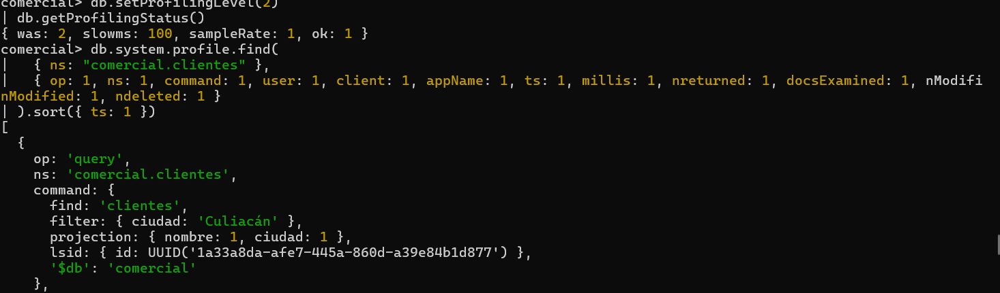

# Evidencia 03 — Perfilador de la base de datos

**Actividad 3 · LAB-02**

## Comandos ejecutados

Sesión del DBA:

```js
db.setProfilingLevel(2)
db.getProfilingStatus()
```

Sesión de la aplicación (consulta, actualización y eliminación):

```bash
mongosh "mongodb://app_ventas:<REDACTED>@127.0.0.1:27017/comercial?appName=app-ventas-web" --quiet --eval 'db.clientes.find({ ciudad: "Culiacán" }, { nombre: 1, ciudad: 1 }).toArray(); db.clientes.updateOne({ _id: 3 }, { $set: { rfc: "GAMA780912XYZ" } }); db.clientes.deleteOne({ _id: 2 });'
```

Lectura de `system.profile`:

```js
db.system.profile.find(
  { ns: "comercial.clientes" },
  { op: 1, ns: 1, command: 1, user: 1, client: 1, appName: 1, ts: 1, millis: 1, nreturned: 1, docsExamined: 1, nModified: 1, ndeleted: 1 }
).sort({ ts: 1 })
```

## Resultado observado


- `getProfilingStatus()` devolvió `{ was: 2, slowms: 100, sampleRate: 1, ok: 1 }` (nivel 2 vigente).
- La bitácora registró el cambio: `2026-11-11T23:59:25.869-06:00`, `conn43`, `Profiler settings changed`, de `level 0` a `level 2`, base `comercial`.
- Las operaciones de la aplicación se ejecutaron a las **23:59:44** (conexiones `conn47`, `conn48`, `conn49`, todas `app_ventas`, appName `app-ventas-web`, según la bitácora).
- En la captura se ve el primer documento de `system.profile`: `op: 'query'`, `ns: 'comercial.clientes'`, `command: { find: 'clientes', filter: { ciudad: 'Culiacán' }, projection: { nombre: 1, ciudad: 1 }, ..., '$db': 'comercial' }`.

### 9.1 Interpretación de los documentos

| # | `op` | Usuario | Cliente | Aplicación | Momento | Qué hizo | Documentos afectados |
|---|---|---|---|---|---|---|---|
| 1 | `query` | `[COMPLETAR]` | `[COMPLETAR]` | `[COMPLETAR]` | `[COMPLETAR]` | `find` en `clientes` con filtro `ciudad: "Culiacán"` y proyección `nombre`, `ciudad` (observado) | `[COMPLETAR: docsExamined / nreturned]` |
| 2 | `update` | `[COMPLETAR]` | `[COMPLETAR]` | `[COMPLETAR]` | `[COMPLETAR]` | `$set` de `rfc` a `GAMA780912XYZ` donde `_id: 3` (según el comando ejecutado) | `[COMPLETAR: nModified]` |
| 3 | `remove` | `[COMPLETAR]` | `[COMPLETAR]` | `[COMPLETAR]` | `[COMPLETAR]` | eliminación con `q: { _id: 2 }` (según el comando ejecutado) | `[COMPLETAR: ndeleted]` |

## Respuestas

**1. ¿Puedes saber cuál era el RFC antes del cambio con la información de `system.profile`?**
No. El documento del `update` guarda el comando (`q` y `u` con `$set` del **nuevo** valor), pero no el valor anterior del campo. Para conocerlo haría falta un respaldo, un disparador o un mecanismo de historial.

**2. ¿Puedes saber qué datos tenía el documento eliminado?**
No. El perfil de un `remove` registra el filtro (`q: { _id: 2 }`) y cuántos documentos se eliminaron (`ndeleted`), pero no el contenido del documento borrado.

**3. A diferencia de `log_statement = 'mod'` en PostgreSQL, el nivel 2 sí registró la consulta. ¿Qué ventaja y qué riesgo tiene eso?**
- *Ventaja:* se obtiene trazabilidad de **lecturas** (quién consultó qué filtro y cuántos documentos), útil para detectar accesos anómalos a datos sensibles.
- *Riesgo:* el filtro y los valores quedan en `system.profile` en texto claro y pueden contener datos personales (RFC, correo, teléfono), de modo que el propio registro se vuelve un dato sensible que hay que proteger; además el nivel 2 degrada el desempeño, consume disco y, al ser una colección limitada de 1 MB, sobrescribe la evidencia antigua con rapidez.

**4. ¿Por qué el campo `user` incluye `@comercial`?**
Porque en MongoDB un usuario se identifica por **nombre + base de autenticación**: `app_ventas@comercial` significa que el usuario `app_ventas` está definido en la base `comercial`. Así se distingue de un usuario homónimo creado en otra base (por ejemplo, `admin@admin`, como el que aparece en `system-profile.json`).
