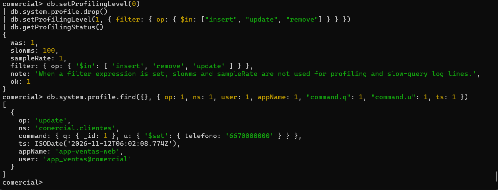

# Evidencia 04 — Reducir el volumen con un filtro

**Actividad 4 · LAB-02**

## Comandos ejecutados

Sesión del DBA:

```js
db.setProfilingLevel(0)
db.system.profile.drop()
db.setProfilingLevel(1, { filter: { op: { $in: ["insert", "update", "remove"] } } })
db.getProfilingStatus()
```

Sesión de la aplicación (una consulta y una actualización):

```bash
mongosh "mongodb://app_ventas:<REDACTED>@127.0.0.1:27017/comercial?appName=app-ventas-web" --quiet --eval 'db.clientes.find({ _id: 1 }).toArray(); db.clientes.updateOne({ _id: 1 }, { $set: { telefono: "6670000000" } })'
```

Lectura:

```js
db.system.profile.find({}, { op: 1, ns: 1, user: 1, appName: 1, "command.q": 1, "command.u": 1, ts: 1 })
```

## Resultado observado



`getProfilingStatus()` tras aplicar el filtro:

```
{
  was: 1, slowms: 100, sampleRate: 1,
  filter: { op: { '$in': [ 'insert', 'remove', 'update' ] } },
  note: 'When a filter expression is set, slowms and sampleRate are not used for profiling and slow-query log lines.',
  ok: 1
}
```

Documento recuperado de `system.profile` (solo existe el `update`; la consulta **no** se registró):

| Campo | Valor |
|---|---|
| `op` | `update` |
| `ns` | `comercial.clientes` |
| `command` | `{ q: { _id: 1 }, u: { '$set': { telefono: '6670000000' } } }` |
| `ts` | `2026-11-12T06:02:08.774Z` (= 00:02:08 hora local) |
| `appName` | `app-ventas-web` |
| `user` | `app_ventas@comercial` |

La bitácora respalda el cambio de configuración: `2026-11-12T00:01:47.121` (`conn43`) nivel 2 → 0; `00:01:47.148` `CMD: drop`; `00:01:47.190` nivel 0 → 1 con el filtro `op $in [insert, remove, update]`. Las conexiones de la aplicación son `conn51`–`conn53` (00:02:08).


## Respuestas

**1. ¿Qué perdiste de evidencia al aplicar el filtro? ¿Qué ganaste?**
- *Perdí:* todas las lecturas (`query`) y los comandos administrativos; la consulta `find({ _id: 1 })` ya no aparece. Si alguien exfiltra datos solo leyendo, el filtro no deja rastro. Además, al hacer `drop()` se perdió el historial anterior.
- *Gané:* un volumen mucho menor (solo insert/update/remove), menos costo de desempeño y menos datos personales almacenados en el perfilador, y una colección de 1 MB que tarda más en sobrescribirse.

**2. ¿Qué filtro usarías si solo interesaran operaciones sobre la colección `clientes`?**

```js
db.setProfilingLevel(1, { filter: { ns: "comercial.clientes" } })
```

Para quedarme solo con las modificaciones de esa colección: `{ filter: { ns: "comercial.clientes", op: { $in: ["insert", "update", "remove"] } } }`.
