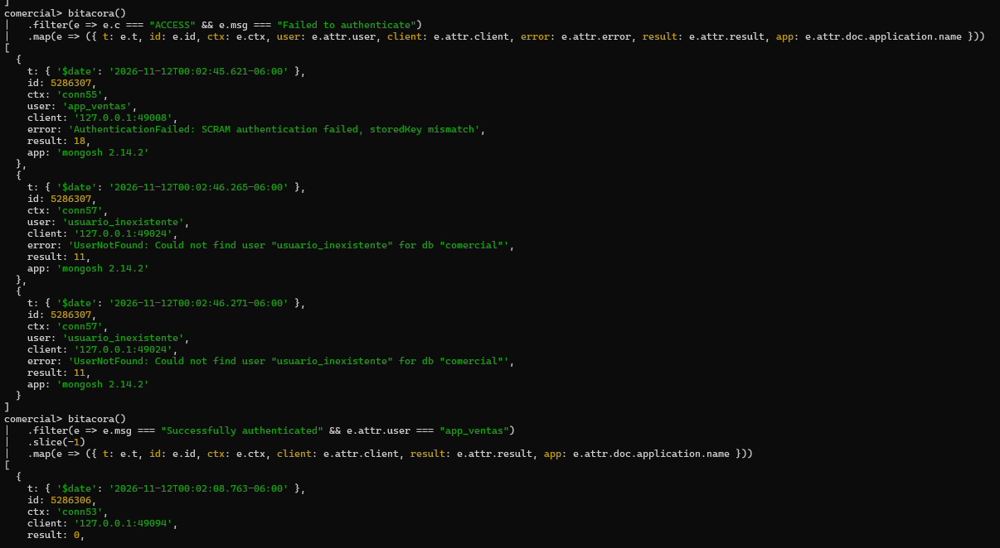

# Evidencia 05 — Accesos en la bitácora de `mongod`

**Actividad 5 · LAB-02**

## Comandos ejecutados

Dos intentos fallidos (terminal):

```bash
mongosh "mongodb://app_ventas:<REDACTED>@127.0.0.1:27017/comercial" --quiet --eval "db.clientes.countDocuments()"
mongosh "mongodb://usuario_inexistente:<REDACTED>@127.0.0.1:27017/comercial" --quiet --eval "db.clientes.countDocuments()"
```

Lectura de la bitácora (sesión del DBA):

```js
bitacora()
  .filter(e => e.c === "ACCESS" && e.msg === "Failed to authenticate")
  .map(e => ({ t: e.t, id: e.id, ctx: e.ctx, user: e.attr.user, client: e.attr.client, error: e.attr.error, result: e.attr.result, app: e.attr.doc.application.name }))

bitacora()
  .filter(e => e.msg === "Successfully authenticated" && e.attr.user === "app_ventas")
  .slice(-1)
  .map(e => ({ t: e.t, id: e.id, ctx: e.ctx, client: e.attr.client, result: e.attr.result, app: e.attr.doc.application.name }))
```

## Resultado observado



**Accesos fallidos** (hora local UTC-6, 2026-11-12):

| Hora | `ctx` | Usuario | Cliente | `result` | Error |
|---|---|---|---|---|---|
| 00:02:45.621 | `conn55` | `app_ventas` | `127.0.0.1:49008` | 18 | `AuthenticationFailed: SCRAM authentication failed, storedKey mismatch` |
| 00:02:46.265 | `conn57` | `usuario_inexistente` | `127.0.0.1:49024` | 11 | `UserNotFound: Could not find user "usuario_inexistente" for db "comercial"` |
| 00:02:46.271 | `conn57` | `usuario_inexistente` | `127.0.0.1:49024` | 11 | (mismo error, segunda línea del mismo intento) |

Aplicación que reporta: `mongosh 2.14.2`. Se identifican **tres líneas pero dos intentos**.

**Último acceso exitoso de `app_ventas`:** 2026-11-12 00:02:08.763 (hora local), `id: 5286306`, `ctx: conn53`, `client: 127.0.0.1:49094`, `result: 0` (la bitácora exportada lo registra con appName `app-ventas-web`). La captura lo corta justo después de `result: 0`.

Cuenta total en la bitácora exportada: 25 eventos `Successfully authenticated` (13 de `app_ventas`) y 3 `Failed to authenticate`.

## Respuestas

**1. ¿Qué campo distingue un acceso fallido de uno exitoso?**
El mensaje (`msg`: `Failed to authenticate` frente a `Successfully authenticated`), apoyado por el `id` (5286307 el fallido, 5286306 el exitoso) y por `attr.result` (distinto de 0 en los fallidos: 18 y 11; `0` en el exitoso). El fallido además trae `attr.error` con el motivo.

**2. ¿Qué diferencia hay entre el error de contraseña incorrecta y el de usuario inexistente? ¿Por qué el cliente recibe el mismo mensaje en ambos casos?**
En la bitácora son distintos: contraseña incorrecta → `AuthenticationFailed ... storedKey mismatch` (resultado 18); usuario inexistente → `UserNotFound` (resultado 11). Al cliente se le entrega un mensaje genérico en los dos casos (la guía documenta `MongoServerError: Authentication failed.`; esa salida de terminal no está en las capturas aportadas) para **no revelar qué usuarios existen** y evitar la enumeración de usuarios. El detalle solo lo ve quien tiene acceso a la bitácora del servidor.

**3. ¿Por qué el nombre de la aplicación del intento fallido es `mongosh 2.14.2` y no `app-ventas-web`?**
Porque las cadenas de conexión de los intentos fallidos **no incluían** `?appName=app-ventas-web`; sin esa opción, el cliente reporta su nombre y versión por defecto (`mongosh 2.14.2`). Es un recordatorio de que `appName` lo declara el cliente y no se puede usar como prueba de identidad.
