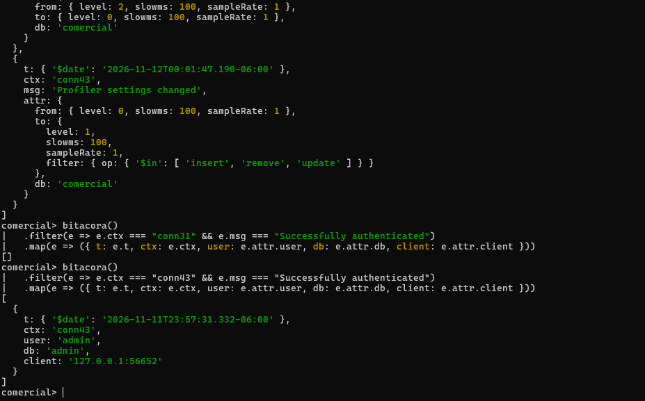

# Evidencia 06 — Correlacionar un cambio de configuración con su autor

**Actividad 6 · LAB-02**

## Comandos ejecutados (sesión del DBA)

```js
bitacora()
  .filter(e => e.msg === "Profiler settings changed")
  .map(e => ({ t: e.t, ctx: e.ctx, msg: e.msg, attr: e.attr }))

// Primer intento con el ctx de ejemplo de la guía
bitacora()
  .filter(e => e.ctx === "conn31" && e.msg === "Successfully authenticated")
  .map(e => ({ t: e.t, ctx: e.ctx, user: e.attr.user, db: e.attr.db, client: e.attr.client }))

// Con el ctx real de este entorno
bitacora()
  .filter(e => e.ctx === "conn43" && e.msg === "Successfully authenticated")
  .map(e => ({ t: e.t, ctx: e.ctx, user: e.attr.user, db: e.attr.db, client: e.attr.client }))
```

## Resultado observado



Último evento `Profiler settings changed` (hora local):

- `2026-11-12T00:01:47.190-06:00`, `ctx: conn43`, base `comercial`, de `level 0` a `level 1` con `filter: { op: { $in: ['insert','remove','update'] } }`.
- **La línea no incluye el usuario**; solo el contexto `conn43`.

Primer intento con `conn31` (valor de ejemplo de la guía): resultado `[]`, porque en este servidor esa conexión no corresponde.

Autenticación de la misma conexión (`conn43`):

| Hora | `ctx` | Usuario | Base | Cliente |
|---|---|---|---|---|
| 2026-11-11T23:57:31.332-06:00 | `conn43` | `admin` | `admin` | `127.0.0.1:56652` |

Línea de tiempo de los cambios de configuración del perfilador en la bitácora exportada (todos desde `conn43`):

| Hora local | Cambio | `ctx` |
|---|---|---|
| 2026-11-11 23:59:25.869 | nivel 0 → 2 | `conn43` |
| 2026-11-12 00:01:47.121 | nivel 2 → 0 | `conn43` |
| 2026-11-12 00:01:47.190 | nivel 0 → 1 con filtro `insert/remove/update` | `conn43` |
| 2026-11-12 00:05:43.805 | nivel 1 → 2 (conserva el filtro) | `conn43` |
| 2026-11-12 00:07:02.401 | nivel 2 → 1 (con filtro) | `conn43` |

## Respuestas

**1. ¿Qué usuario cambió la configuración del perfilador? ¿Qué dos eventos lo demuestran?**
El usuario **`admin`** (base `admin`). Los dos eventos son: (a) `Profiler settings changed` en `conn43` a las 00:01:47.190, que indica *qué* cambió pero no *quién*; y (b) `Successfully authenticated` en `conn43` a las 23:57:31.332, con `user: admin`, que indica *quién* abrió esa conexión. El nexo entre ambos es el `ctx`.

**2. ¿Qué condición debe cumplirse para que esta correlación sea válida?**
Que ambos eventos pertenezcan a la **misma ejecución del servidor**: los números de conexión (`connNN`) reinician en cada arranque de `mongod`, de modo que tras un reinicio el mismo `conn43` podría ser otro usuario. En esta bitácora hay un único arranque (22:24 del 2026-11-11) y no se observa reinicio, así que la correlación es válida. Además, el evento de autenticación debe seguir disponible (en `getLog` solo están los 1024 eventos más recientes) y la conexión no debe haberse reautenticado como otro usuario.

**3. ¿Por qué es relevante que quede registrado un cambio de configuración del propio mecanismo de registro?**
Porque quien quiera ocultar su actividad primero apagaría o filtraría el perfilador. Que ese cambio quede en la bitácora (con valores `from` y `to`) permite detectar el intento y reconstruir ventanas sin cobertura, por ejemplo el periodo en que el nivel estuvo en 0. Es la clase de evento que debe vigilarse de forma explícita. El límite: la línea no indica el autor y exige la correlación manual por `ctx`.
