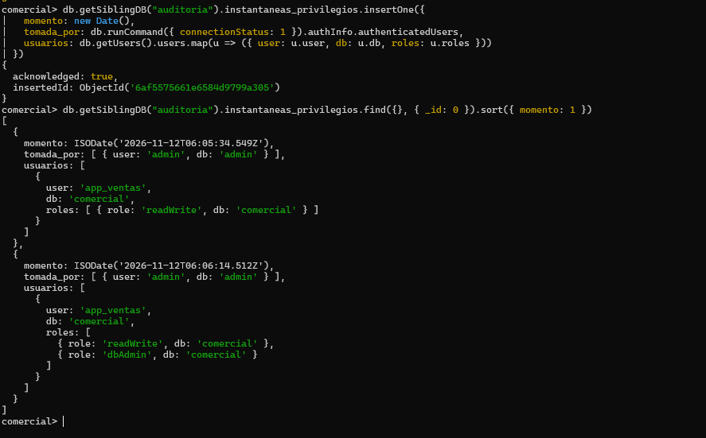

# Evidencia 07 — Cambios de privilegios: el límite más importante

**Actividad 7 · LAB-02**

## Comandos ejecutados (sesión del DBA)

Instantánea 1 (antes del cambio):

```js
db.getSiblingDB("auditoria").instantaneas_privilegios.insertOne({
  momento: new Date(),
  tomada_por: db.runCommand({ connectionStatus: 1 }).authInfo.authenticatedUsers,
  usuarios: db.getUsers().users.map(u => ({ user: u.user, db: u.db, roles: u.roles }))
})
```

Cambio de privilegios y búsqueda de evidencia:

```js
db.setProfilingLevel(2)
db.grantRolesToUser("app_ventas", [{ role: "dbAdmin", db: "comercial" }])
db.system.profile.countDocuments({ "command.grantRolesToUser": { $exists: true } })
bitacora().filter(e => JSON.stringify(e).includes("grantRoles")).length
```

Instantánea 2 (repetir el `insertOne`) y comparación:

```js
db.getSiblingDB("auditoria").instantaneas_privilegios.find({}, { _id: 0 }).sort({ momento: 1 })
```

Restablecimiento:

```js
db.revokeRolesFromUser("app_ventas", [{ role: "dbAdmin", db: "comercial" }])
db.setProfilingLevel(1, { filter: { op: { $in: ["insert", "update", "remove"] } } })
```

## Resultado observado



| Instantánea | `momento` (UTC) | Hora local | Tomada por | Roles de `app_ventas` |
|---|---|---|---|---|
| 1 | `2026-11-12T06:05:34.549Z` | 00:05:34 | `admin@admin` | `readWrite@comercial` |
| 2 | `2026-11-12T06:06:14.512Z` | 00:06:14 | `admin@admin` | `readWrite@comercial`, `dbAdmin@comercial` |

Eventos de la bitácora que acotan el cambio (hora local): nivel del perfilador 1 → 2 a las **00:05:43.805** y 2 → 1 a las **00:07:02.401** (ambos `conn43`, `admin`). El `grantRolesToUser` ocurrió, por tanto, entre la instantánea 1 y la 2 (ventana de ≈ 40 s).

**Búsqueda del cambio en las fuentes de trazabilidad** (verificada sobre los archivos exportados):

| Fuente | Resultado |
|---|---|
| `bitacora-mongod.log` (522 eventos) | **0** eventos con `grantRoles` o `revokeRoles` |
| `system-profile.json` (2 documentos) | **0** documentos con `grantRolesToUser` |

El `system-profile.json` contiene el `update` de la Actividad 4 y un documento `op: 'command'`, `ns: 'comercial.system.profile'`, `user: 'admin@admin'`, a las `06:05:47.813Z` (00:05:47 local), cuando el nivel 2 estaba activo. Es compatible con la propia consulta de `system.profile` hecha durante la búsqueda anterior, pero no hay captura que lo confirme.

| Pregunta | ¿La instantánea responde? |
|---|---|
| ¿Cambiaron los privilegios de `app_ventas`? | **Sí** (aparece `dbAdmin` en la 2) |
| ¿Qué rol se agregó? | **Sí**: `dbAdmin@comercial` |
| ¿Quién lo agregó? | **No** |
| ¿Cuándo exactamente? | **No**, solo que ocurrió entre `06:05:34.549Z` y `06:06:14.512Z` |

## Respuestas

**1. ¿Por qué un cambio de privilegios es uno de los eventos auditables más importantes?**
Porque modifica *quién puede hacer qué*: es el camino habitual para escalar privilegios, crear persistencia y desactivar controles. Un solo `grantRolesToUser` puede dar a una aplicación la capacidad de administrar la base, y sin registro no hay forma de saber quién lo hizo ni cuándo. Es la base sobre la que descansan los demás controles (autenticación, mínimo privilegio, segregación de funciones).

**2. ¿Con qué frecuencia tomarías instantáneas? ¿Qué factores influyen?**
Dependería del riesgo. Para un servidor con datos personales, al menos diaria y automática, y además inmediatamente antes y después de cada ventana de cambios autorizados, con comparación automática (diff) y alerta ante cualquier diferencia no justificada. Influyen: la criticidad de los datos, el número de administradores, la frecuencia de cambios legítimos, el costo/volumen de cada instantánea y el tiempo máximo que la organización tolera sin detectar un cambio. Cuanto mayor el intervalo, mayor la ventana en la que no se puede acotar el cuándo.

**3. ¿Quién debería poder escribir en `auditoria.instantaneas_privilegios`?**
Solo una cuenta de servicio dedicada al proceso de instantáneas, con un rol que permita únicamente `insert` en esa colección (sin `update`/`remove`) y sin ser usada por la aplicación ni por administradores en sesiones interactivas. Idealmente, la información se copia además a un almacenamiento externo de solo escritura, porque un administrador con `root` (como `admin` en este laboratorio) podría alterar la colección local. La aplicación `app_ventas` nunca debe tener acceso a ella.

**4. Redacta en tres líneas cómo comunicarías esta limitación a Dirección.**
> 1. Sabemos que `app_ventas` recibió el rol `dbAdmin` y cuándo (en una ventana de unos 40 segundos), porque comparamos dos fotografías de los privilegios.
> 2. No podemos decir **quién** lo hizo: MongoDB Community no tiene auditoría nativa de cambios de privilegios y el perfilador y la bitácora no lo registraron.
> 3. Es un control compensatorio, no auditoría; para responder "quién" con certeza se necesita MongoDB Enterprise/Atlas o controles adicionales de acceso y registro.
